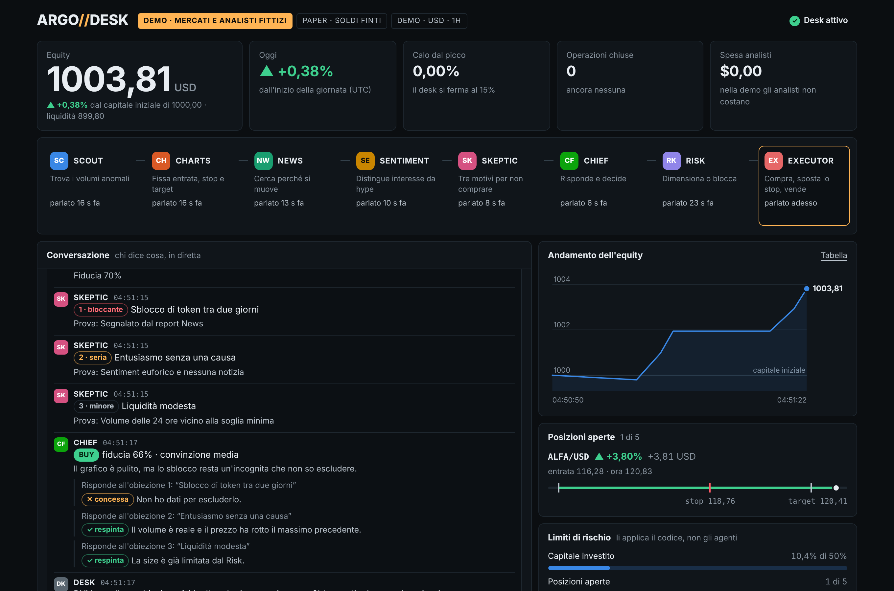

# Trading Desk

Un desk di trading crypto spot fatto di più agenti: alcuni sono codice, altri sono
modelli Claude. Scansiona i mercati più liquidi di un exchange, discute ogni occasione
e, se supera tutti i controlli, compra e gestisce l'uscita. Parte in **paper trading**:
prezzi veri, soldi finti.

Non è una macchina per fare soldi. Nessuno dei numeri che girano sui social
("$89 → $68.024") è riproducibile, e la maggior parte dei bot retail perde. Quello che
questo progetto ti dà è un sistema che puoi leggere, misurare con un backtest e far
girare a rischio zero finché i numeri non ti convincono.

## Chi siede al desk

| Agente | Cosa fa | Chi decide |
|---|---|---|
| **Scout** | Trova i mercati con volume anomalo e prezzo in salita | codice |
| **Charts** | Legge il trend e fissa entrata, stop e target | codice |
| **News** | Cerca sul web perché il mercato si sta muovendo | Claude + ricerca web |
| **Sentiment** | Distingue interesse reale da hype | Claude + ricerca web |
| **Skeptic** | Deve dare tre motivi concreti per non comprare | Claude |
| **Chief** | Risponde alle obiezioni e decide BUY, WAIT o SKIP | Claude |
| **Risk** | Dimensiona, riduce o blocca ogni operazione | codice |
| **Executor** | Compra, sposta lo stop, vende | codice |

```
Scout → Charts → Risk (controllo preventivo) → News + Sentiment → Skeptic → Chief → Risk → Executor
```

Tre scelte di progetto contano più delle altre:

- **I numeri li fa il codice.** Livelli, size e stop sono calcolati, non stimati da un
  modello. Gli stessi calcoli girano dal vivo e nel backtest.
- **Gli analisti giudicano, non toccano soldi.** Il BUY del Chief è una richiesta.
  Viene annullato se un'obiezione seria dello Skeptic resta senza risposta o se la
  fiducia è sotto soglia, e poi passa comunque dal Risk.
- **Il Risk ha l'ultima parola.** È codice: nessun prompt e nessuna pagina web letta
  dagli analisti può fargli superare i limiti.

## Per iniziare

Il modo più semplice: fai doppio clic su `start.bat` (Windows) oppure lancia `./start.sh`
(Mac, Linux). Installa quello che serve, avvia il desk in paper trading e apre la
dashboard nel browser. Se in `.env` c'è una chiave Anthropic usa gli analisti, altrimenti
decide con le sole regole. Entrambi sono stati provati: `start.sh` su Linux, `start.bat`
su un PC Windows 11.

Sul PC, mentre il desk è acceso:

- **Il PC non va in sospensione** da solo (lo schermo può spegnersi). Chiudere il
  portatile o scegliere Sospendi lo ferma comunque: al risveglio il diario dice per
  quanti minuti è rimasto fermo.
- **La finestra nera va lasciata aperta**: chiuderla ferma il desk. Gira un solo desk
  alla volta; un secondo doppio clic apre la dashboard di quello già acceso.
- **Se cade la connessione** il desk non compra (non può verificare il trend di BTC),
  tiene i prezzi dell'ultima valutazione e riprova la scansione dopo cinque minuti.
- **Antivirus che analizzano le connessioni HTTPS** (Avast, Kaspersky, Bitdefender...):
  il desk usa i certificati di Windows, come il browser, quindi funziona anche con loro.

### Avvio automatico su Windows

Per un desk che resta acceso da solo, usa l'avvio automatico invece di `start.bat`.
Una volta sola, dalla cartella `trading-desk`, in PowerShell:

```
powershell -NoProfile -ExecutionPolicy Bypass -File install-autostart.ps1
```

Crea l'attività pianificata "ARGO DESK":
- parte 30 secondi dopo l'accesso, senza diritti di amministratore;
- **gira in background, senza finestre**, così nessuno la chiude per sbaglio su un PC
  condiviso;
- controlla ogni minuto che il desk sia acceso e, se il programma si blocca, lo
  riaccende entro un minuto.

Per vedere il desk apri la dashboard: `http://127.0.0.1:9787` per lo spot, di solito
`http://127.0.0.1:9788` per i perpetui. Sul desktop compaiono due icone:
- **FERMA ARGO DESK** lo spegne e lo tiene spento;
- **AVVIA ARGO DESK** lo riaccende.

Il desk dei perpetui ha un'attività sua, "ARGO DESK PERPETUI", con le sue icone
FERMA e AVVIA:

```
powershell -NoProfile -ExecutionPolicy Bypass -File install-autostart.ps1 -Market perps
```

Ciascuna icona ferma o riavvia solo il suo desk. `install-autostart.ps1 -Uninstall`
toglie l'avvio automatico dello spot, `-Market perps -Uninstall` quello dei perpetui.
Ogni avvio e ogni fermata vengono scritti in `data/autostart.log` e in
`data/autostart-perps.log`.

A mano serve [uv](https://docs.astral.sh/uv/).

```bash
cd trading-desk
uv sync
cp .env.example .env        # facoltativo: i default sono già in paper trading

uv run desk scan            # cosa vedono ora Scout e Charts
uv run desk backtest --days 30
uv run desk run --rules-only   # desk in continuo, senza analisti LLM, soldi finti
uv run desk snapshot        # i dati per la pagina ARGO DESK Live su claude.ai
```

Per accendere gli analisti ci sono due strade:

- **Con l'abbonamento Claude, senza chiave.** Se sul PC c'è Claude Code con il tuo
  accesso, metti `DESK_ANALYSTS=claude-code` in `.env`. Ogni analista è una domanda a
  Claude Code in modalità silenziosa:
  - una sessione nuova ogni volta, che non viene salvata, in una cartella vuota fuori da
    quella del desk (su Windows `%LOCALAPPDATA%\argo-desk\analysts`). Se dentro compare
    qualcosa, per esempio un CLAUDE.md, gli analisti non partono;
  - la ricerca web solo per News e Sentiment;
  - nessun altro strumento, nessun server MCP, nessuno slash command e nessun hook;
  - nessun plugin, compresi quelli sincronizzati da claude.ai, e nessun file di
    impostazioni: né i tuoi né quelli di una cartella.

  L'abbonamento è lo stesso che usi tu, quindi gli analisti discutono al massimo
  `DESK_ANALYST_MAX_PER_HOUR` mercati all'ora (3) e `DESK_ANALYST_MAX_PER_DAY` al giorno
  (20), **contando insieme i due desk**: il conto sta in `data/analysts-budget.db`.
  Ogni mercato discusso costa quattro domande. Il modello è `DESK_CLAUDE_CODE_MODEL`
  (sonnet). Se Claude Code manca o risponde con un errore, per esempio un limite d'uso
  raggiunto, su quel mercato non si apre niente.

  Su Windows il desk avvia **solo il programma vero, `claude.exe`**, mai `claude.cmd` o
  `claude.ps1`, gli script che npm mette nel PATH. Quegli script passano da cmd.exe o da
  PowerShell: cmd.exe taglia le istruzioni al primo a capo, e con loro i flag che
  chiudono Claude Code nella sua cartella, e legge come comandi i simboli `&`, `|`, `<`
  e `>` del testo preso dal web. Il desk cerca `claude.exe`, in quest'ordine:
  1. `DESK_CLAUDE_CODE_PATH`, che deve finire in `.exe`;
  2. la cartella del pacchetto npm (`%APPDATA%\npm\node_modules\@anthropic-ai\claude-code\bin`);
  3. `~\.local\bin`, dove lo mette l'installatore;
  4. il PATH.

  Se trova solo gli script, gli analisti restano spenti e la console spiega perché. Il
  diario scrive quale `claude.exe` è stato avviato.

  Mentre gli analisti pensano, il desk resta di guardia:
  - prima di ogni domanda controlla gli stop delle posizioni aperte;
  - una domanda che supera `DESK_CLAUDE_CODE_TIMEOUT` secondi (180) viene fermata, insieme
    a ogni processo che aveva avviato. Su Windows ogni domanda sta in un "job" di sistema,
    che li contiene tutti e solo loro.

  Quando una domanda fallisce, il diario e la pagina live mostrano un messaggio breve,
  senza percorsi né indirizzi e-mail. L'uscita completa resta solo sul PC, in
  `data/analysts-last-error.txt`.
- **Con una chiave API**: metti `ANTHROPIC_API_KEY` in `.env`.

Sul desk dei perpetui gli analisti si accendono solo con `DESK_PERPS_ANALYSTS=true`: quel
desk è stato provato con le sole regole. `DESK_ANALYSTS=off` li spegne su tutti e due i
desk. Un errore di battitura in queste chiavi non ferma i desk: la console lo segnala e
il desk usa il valore di default (per i perpetui: spenti). Lo stesso vale per un valore
fuori misura: timeout tra 10 e 900 secondi, al massimo 30 analisi all'ora e 300 al
giorno. Se il modo degli analisti non si capisce, li spegne.

Poi lancia `uv run desk run`. Gli analisti lavorano sul desk spot e, con
`DESK_PERPS_ANALYSTS=true`, anche su quello dei perpetui, dove discutono anche gli short
con istruzioni scritte per il ribasso (vedi
[Il desk dei perpetui](#il-desk-dei-perpetui-solo-soldi-finti)).

Accanto al desk spot può girare un secondo desk, solo con soldi finti, che opera al
rialzo e al ribasso sui contratti perpetui: vedi [Il desk dei perpetui](#il-desk-dei-perpetui-solo-soldi-finti).

| Comando | A cosa serve |
|---|---|
| `desk scan` | Fotografia del mercato, senza operare |
| `desk cycle` | Un solo giro completo del desk |
| `desk run` | Giro completo a ogni chiusura di candela, controllo delle posizioni ogni minuto. Con `--dashboard` avvia anche la pagina web |
| `desk dashboard` | La pagina web con gli agenti in diretta. Con `--demo` mostra una sessione dimostrativa |
| `desk status` | Equity, posizioni, risultati, spesa stimata per gli analisti |
| `desk snapshot` | Scrive in `data/live` i quattro file della pagina ARGO DESK Live su claude.ai |
| `desk journal` | Chi ha detto cosa e perché |
| `desk backtest` | Le regole rigiocate sullo storico, con commissioni e slippage |
| `desk radar <indirizzo>` | Punteggio di rischio di un token DEX (memecoin) |
| `desk halt` / `desk resume` | Blocca o riattiva le nuove entrate |
| `desk close-all` | Vende tutte le posizioni del desk |

Tutte le impostazioni sono in `.env.example`, con il loro significato.

## La dashboard



`uv run desk run --dashboard --open` avvia il desk e apre `http://127.0.0.1:8787`. Se
quella porta è occupata, o riservata da Windows (succede con WSL, Docker o Hyper-V), la
dashboard ne prende un'altra e il browser si apre comunque sull'indirizzo giusto. Gira un
solo desk alla volta: se lo riavvii mentre è già acceso, ti apre la dashboard di quello
che sta girando invece di partire una seconda volta. La pagina si aggiorna da sola ogni
due secondi e mostra:

- **Gli agenti**: chi ha parlato per ultimo e chi sta lavorando in questo momento
  ("cerca cosa ha mosso il prezzo", "risponde alle obiezioni e decide").
- **La conversazione**: una discussione per ogni mercato, con le obiezioni dello
  Skeptic e sotto, una per una, le risposte del Chief: respinta o concessa.
- **Il conto**: equity, andamento, posizioni aperte rispetto a stop e target, e quanto
  di ogni limite di rischio è già usato.

Per vederla muoversi senza aspettare il mercato: `uv run desk dashboard --demo --open`.
La demo fa girare il desk vero (Scout, Charts, Risk, uscite) su cinque mercati
inventati, con analisti che leggono battute preparate. È marcata come demo in ogni
schermata, e i suoi risultati non dicono nulla su quelli reali.

La pagina è di sola lettura: non ha pulsanti né indirizzi che inviano ordini o cambiano
impostazioni. Non carica nulla da altri siti. Ascolta solo sul tuo computer; per aprirla
da un altro dispositivo della stessa rete aggiungi `--host 0.0.0.0`, sapendo che chiunque
su quella rete potrà vedere il conto.

## Quale piattaforma

Il desk parla con gli exchange attraverso [ccxt](https://github.com/ccxt/ccxt): per
cambiare piattaforma bastano tre righe in `.env`. Se sbagli valuta, `desk scan` ti
elenca quelle quotate sull'exchange.

| Piattaforma | `.env` | Stato |
|---|---|---|
| Kraken | `DESK_EXCHANGE=kraken` `DESK_QUOTE=USD` `DESK_FEE_RATE=0.004` | Provato con dati reali. È il default. |
| BingX | `DESK_EXCHANGE=bingx` `DESK_QUOTE=USDT` `DESK_FEE_RATE=0.001` | Provato con dati reali. |
| Bybit EU (residenti UE) | `DESK_EXCHANGE=bybiteu` `DESK_QUOTE=USDC` | Non provato: blocca per posizione il server di sviluppo. Quota in USDC ed EUR. |
| Bybit globale | `DESK_EXCHANGE=bybit` `DESK_QUOTE=USDT` | Non provato, stesso motivo. |
| Phantom | — | Non supportato: vedi sotto. |
| FOMO | — | Non automatizzabile: non risulta un'API pubblica. |

In `DESK_FEE_RATE` va la commissione taker spot del tuo conto: quella indicata per
BingX è un'ipotesi da verificare.

**Bybit e Bybit EU sono conti diversi.** Chi risiede nell'UE opera su bybit.eu, con
chiavi API proprie che non funzionano su bybit.com e viceversa.

**Phantom è un wallet, non un exchange.** Non ha un'API a cui un bot si collega: per
operare da solo il bot dovrebbe tenere la chiave privata del wallet e scambiare
on-chain. Questo strato non esiste nel progetto. Se un giorno lo aggiungi, usa un
wallet nuovo creato apposta, con dentro solo la cifra che accetti di perdere: mai la
chiave o la frase di recupero del wallet principale.

## Le regole di rischio

- Ogni operazione rischia l'1% del capitale: la size deriva dalla distanza dello stop.
- Massimo 10% del capitale per posizione, 50% investito in totale, 5 posizioni.
- Lo stop sta a 3 ATR dall'entrata. A +1R sale a pareggio; raggiunto il target (3R)
  segue il prezzo a distanza di 1R, così i vincenti possono correre.
- Persa il 3% in un giorno: niente nuove entrate fino al giorno dopo.
- Sceso del 15% dal picco: il desk si ferma finché non lanci `desk resume`.
- Dopo un'uscita in perdita, quel mercato resta escluso per 12 ore.
- Niente operazioni in cui commissioni e slippage superano un terzo del rischio: con
  uno stop stretto su un exchange caro si perde anche avendo ragione.
- Nuovi acquisti solo con BTC in trend rialzista.
- Se il prezzo di una posizione aperta non arriva dall'exchange, niente nuove entrate:
  la perdita del giorno e il calo dal picco non si possono verificare.

## Cosa dice il backtest

Solo regole (Scout, Charts, Risk, uscite), senza analisti, con commissioni e slittamento.

### Tre anni di candele a 4 ore

È il test che conta di più. Copre novembre 2023 – ottobre 2026 sui dati pubblici di
Binance. Usa le 40 monete principali di novembre 2023, scelte prima del periodo di prova:
così il risultato non conta solo le monete che poi sono andate bene.

| Regole | Commissione 0,4% (Kraken) | Commissione 0,1% | Calo massimo | Operazioni |
|---|---|---|---|---|
| stop a 3 ATR, predefinite dal 18/11/2026 | +27,6% | +42,1% | 11,4% | 256 |
| stop a 2 ATR, fino al 18/11/2026 | 0,0% | +37,4% | 15,3% | 374 |
| regole vecchie | −16,1% | −12,0% | 17,1% | 151 |
| BTC comprato e tenuto | +124% | +124% | – | – |

Il calo massimo e le operazioni sono quelli con la commissione di Kraken.

Anno per anno, con lo stop a 3 ATR e la commissione di Kraken, il desk ha fatto +3,9%,
+10,6% e +11,1%. Negli stessi anni BTC ha fatto +103%, +56% e −29%.

Come leggerli:

- **Il desk guadagna poco, ma con regolarità**: circa l'8% l'anno con la commissione di
  Kraken, circa il 12% con quella allo 0,1%, con cali sotto il 12%. Resta positivo anche
  togliendo le 2 operazioni migliori (+19,6%).
- **Tenere BTC ha reso molto di più**, ma con un anno a −29% e cali ben più profondi. Il
  desk rischia l'1% a operazione e investe al massimo metà del capitale: è un'altra cosa.
- **Lo stop a 3 ATR batte quello a 2 ATR in tutti e quattro i casi provati**: le 40 monete
  del 2023 e le monete di oggi, ciascune con le due commissioni. Uno stop più largo viene
  colpito meno dal rumore, e le commissioni pesano meno rispetto al rischio.
- **Scegliere le regole sul passato e giudicarle sul futuro regge.** La regola migliore
  sul primo anno, scelta senza guardare gli altri due (filtro su BTC meno severo, stop a
  3 ATR), ha fatto +7,1% e +6,5% nei due anni dopo, con la commissione di Kraken.
- **Limiti:**
  - gli analisti AI non ci sono;
  - i prezzi sono quelli in USDT di Binance, non in USD di Kraken;
  - si entra all'apertura della candela successiva con lo 0,1% di slittamento;
  - su 16 combinazioni provate, quella scelta è anche un po' fortunata.

Rifallo tu, dalla cartella `trading-desk`:

```
uv run python research/download.py
uv run python research/walk.py
uv run python research/full.py
```

Il primo scarica i dati, il secondo prova ogni anno a parte, il terzo i tre anni di fila.

### Rialzo e ribasso sui contratti perpetui (ricerca)

Il desk spot compra solo al rialzo. Queste regole le mette in pratica il
[desk dei perpetui](#il-desk-dei-perpetui-solo-soldi-finti), solo con soldi finti. Il test usa tre anni di
contratti perpetui di Binance (novembre 2023 – ottobre 2026), con i finanziamenti veri
e la commissione dei perpetui (0,05%). Le monete sono le 36 del 2023 senza le memecoin,
che restano senza leva.

Le regole al ribasso sono quelle al rialzo rovesciate, senza ritocchi:
- un picco di volume mentre il prezzo scende;
- trend al ribasso;
- chiusura sotto il minimo delle 20 candele precedenti;
- stop sopra l'entrata, target 3R sotto.

Si apre al rialzo solo con BTC in salita, e al ribasso solo con BTC in discesa.

| Modo | Anno 1 | Anno 2 | Anno 3 | 3 anni | Calo massimo |
|---|---|---|---|---|---|
| solo rialzo | +3,5% | +7,8% | +13,1% | +26,2% | 7,5% |
| solo ribasso | +4,4% | −4,5% | +20,4% | +19,9% | 7,9% |
| rialzo e ribasso | +8,0% | +2,9% | +36,2% | +51,3% | 8,8% |
| rialzo e ribasso, misura piena | +10,1% | +9,1% | +63,2% | +95,9% | 14,9% |
| BTC comprato e tenuto | +103% | +56% | −29% | +124% | – |

- **Il ribasso aggiunge davvero.** Nei 3 anni le operazioni al ribasso hanno reso +224 $
  su 99 operazioni, quasi tutto nell'anno in cui BTC perdeva il 29%. Nell'anno 2 hanno
  perso il 4,5%.
- **La leva non aumenta il rischio per operazione**, che resta l'1% del capitale allo
  stop. Serve solo a tenere bloccato meno capitale, così la posizione può avere la
  dimensione piena invece di fermarsi al 10% del capitale. Con la "misura piena" le
  posizioni insieme arrivano a 1,5 volte il capitale, con al massimo x3 su una sola: il
  risultato quasi raddoppia e il calo massimo sale dall'8,8% al 14,9%. Nessuna
  liquidazione in 3 anni: lo stop arriva sempre molto prima.
- **Il "sentimento" misurato con i finanziamenti non aiuta.** Saltare i rialzi quando
  tutti sono già al rialzo, e viceversa, dà +49,8% invece di +51,3%.
- **Limiti:**
  - le regole al ribasso sono nuove e provate su un solo periodo, senza un anno tenuto da
    parte per la verifica;
  - l'anno 3, al ribasso, pesa molto sul totale;
  - per i soldi veri va verificato quale exchange offre i perpetui a un cliente
    privato in Italia.

Rifallo tu: `uv run python research/perps.py download`, poi `uv run python research/perps.py run`.

**Il posizionamento degli altri trader.** Binance pubblica ogni 5 minuti, per ogni
perpetuo:
- le posizioni aperte (open interest);
- quanti conti sono al rialzo e quanti al ribasso;
- come sono posizionati i trader più grandi.

Quattro regole, decise prima di guardare i risultati, sono state provate sul modo
"rialzo e ribasso":

| Regola | Anno 1 | Anno 2 | Anno 3 | 3 anni | Calo massimo |
|---|---|---|---|---|---|
| nessun filtro | +8,0% | +2,9% | +36,2% | +51,3% | 8,8% |
| A, contro la folla | +9,0% | +0,8% | +33,1% | +46,1% | 8,8% |
| B, con i grandi trader | −1,2% | +1,8% | +29,1% | +29,9% | 8,8% |
| **C, soldi nuovi: posizioni aperte in crescita da 24 ore** | +9,3% | +6,0% | +38,1% | **+59,8%** | **7,7%** |
| D, tutte e tre insieme | +0,8% | +2,6% | +18,5% | +22,6% | 6,7% |

Solo la regola C aiuta, e in tutti e tre gli anni. La sua idea è classica: una rottura
regge quando entrano posizioni nuove, non quando chi era già dentro chiude. Scelta
guardando solo l'anno 1, avrebbe fatto meglio anche negli anni 2 e 3. Con la misura
piena e la regola C, nei 3 anni il risultato è +109%, con un calo massimo del 13,5%, ed
è positivo ogni anno: +11,4%, +15,0% e +63,7%. Le altre tre regole peggiorano: seguire o
contrastare la folla, in questi dati, non paga.

Rifallo tu: `uv run python research/derivs.py download`, poi `uv run python research/derivs.py run`.

### Quattro storici brevi (Kraken e BingX)

Prima del test lungo, il 18/11/2026 il desk è stato rigiocato su quattro storici brevi,
con le regole del 17/11 (stop a 2 ATR).

| Storico | Periodo | BTC tenuto fermo | Regole vecchie | Stop 2 ATR, commissione 0,4% | Stop 2 ATR, commissione 0,1% |
|---|---|---|---|---|---|
| Kraken, 1h, 39 mercati | 30 giorni | −20,9% | −8,6% | −5,6% | −4,5% |
| Kraken, 4h, 39 mercati | 120 giorni | −0,5% | +1,8% | +8,5% | +12,4% |
| BingX, 1h, 29 mercati | 6 mesi | −17,6% | −5,3% | −2,1% | −0,3% |
| BingX, 4h, 29 mercati | 1 anno | −22,9% | −9,6% | −0,4% | +1,0% |

Con lo stop a 3 ATR e la commissione di Kraken, sugli stessi storici: −8,1%, +0,9%,
−3,1% e +4,6%. È peggio in tre casi su quattro, ma sono periodi corti, con 13–51
operazioni ciascuno: pesano meno dei tre anni.

Le regole predefinite:

- **candele a 4 ore**: meno operazioni, quindi meno commissioni;
- **filtro di mercato severo**: nuovi acquisti solo con BTC in trend rialzista, non solo
  quando BTC non scende (`DESK_REGIME_STRICT`);
- **rottura vera**: la candela deve chiudere sopra il massimo delle 20 precedenti
  (`DESK_BREAKOUT_LOOKBACK`);
- **target a 3R** invece di 2R (`DESK_REWARD_RISK`);
- **stop a 3 ATR** invece di 2 (`DESK_ATR_STOP_MULT`).

In generale:

- **Le commissioni contano quanto le regole.** Kraken costa 0,4% per lato; Bybit EU,
  Binance e BingX circa 0,1%. Il paper trading usa la commissione vera di Kraken.
- Gli analisti LLM non sono nel backtest. Possono solo scartare operazioni che le
  regole farebbero: se migliorano o peggiorano il risultato lo dirà il paper trading.

`uv run desk backtest --days 120` rifà il backtest su Kraken. Kraken fornisce al massimo
720 candele di storico per mercato: 120 giorni a 4 ore, 30 a 1 ora.

## Leva simulata

Il backtest e il desk in diretta tengono anche dei **conti ombra con la leva** (x1, x3,
x5, x10, x15, x20): le stesse operazioni del desk su un contratto perpetuo a margine
isolato, con la commissione sul valore intero della posizione (0,05%), il finanziamento
pagato ogni 8 ore (0,01%) e la liquidazione quando il prezzo scende sotto
entrata × (1 − 1/leva + 1%). Una posizione liquidata perde tutto il suo margine. È solo
una simulazione: il desk non apre mai posizioni con leva e la leva non cambia le sue
decisioni.

**Le memecoin restano senza leva.** La leva si simula solo sulle monete grandi con un
mercato dei perpetui profondo: BTC, ETH, SOL, XRP, BNB, ADA, AVAX, LINK, LTC, BCH, DOT,
TRX, TON, XLM, XMR, ZEC, ETC, ATOM, NEAR, SUI, APT, ARB, OP, AAVE, UNI, HBAR, ICP, INJ,
TAO, ENA, CRV, FIL, HYPE, QNT (`DESK_LEVERAGE_BASES`). Un'operazione su qualsiasi altra
moneta, memecoin o moneta appena nata, resta solo spot, e il diario lo dice.

Se il PC resta spento o senza rete, al riavvio il desk legge il prezzo più basso del
periodo: se è sceso sotto il livello di liquidazione, quella leva risulta liquidata, come
avrebbe fatto l'exchange anche senza il desk a guardare.

Sui 120 giorni di Kraken a 4 ore, con le regole di oggi (51 operazioni, 39 sulle monete
ammesse alla leva):

| Leva | Rendimento | Calo massimo | Liquidate |
|---|---|---|---|
| spot, il desk | +8,5% | 4,4% | – |
| x1 | +7,9% | 3,2% | 0 su 39 |
| x3 | +24,0% | 9,3% | 0 su 39 |
| x5 | +40,5% | 15,0% | 0 su 39 |
| x10 | +81,3% | 27,8% | 0 su 39 |
| x15 | +118,9% | 37,7% | 3 su 39 |
| x20 | +56,7% | 65,9% | 15 su 39 |

Da leggere con prudenza:

- le regole di oggi sono state scelte proprio su questi storici, e la leva moltiplica
  anche la fortuna di quella scelta;
- sugli stessi 120 giorni con le regole vecchie x20 perde il 57,8% (21 posizioni
  liquidate su 64); nel mese di Kraken a 1 ora, con BTC a −21%, anche con le regole
  di oggi x10 perde il 19,1% e x20 il 36,5%;
- oltre x10 le liquidazioni si mangiano il guadagno: x20 rende meno di x15, con un calo
  massimo quasi doppio.

Il dettaglio per livello lo stampa `desk backtest`.

## Il desk dei perpetui (solo soldi finti)

Un secondo desk, separato da quello spot, che opera **al rialzo e al ribasso** sui
contratti perpetui in USDT, letti da Bybit. Segue le regole della ricerca qui
sopra: rialzo e ribasso, misura piena, regola C delle posizioni aperte. È **solo paper
trading**: prezzi veri, soldi finti. Non usa chiavi API e si rifiuta di partire con
`DESK_MODE=live` o `--live`.

**Come si avvia.** Doppio clic su `start-perps.bat` (Windows) oppure `./start-perps.sh`
(Mac, Linux): usa gli analisti se sono accesi e disponibili, altrimenti le sole regole.
Si apre una seconda finestra, "ARGO DESK PERPETUI", con la sua dashboard
su `http://127.0.0.1:8788`; se la porta è occupata ne prende un'altra e la scrive. Il
desk spot continua a girare come prima. I due desk hanno ciascuno il suo database
(`data/desk-paper-perps.db` per i perpetui), il suo capitale finto e il suo diario.
Ogni comando accetta `--market perps`, per esempio `uv run desk status --market perps`.

**Cosa cambia rispetto allo spot:**
- **Long e short.** Con BTC in salita apre solo posizioni al rialzo (long), con BTC in
  discesa solo al ribasso (short, che guadagna se il prezzo scende), con BTC laterale
  niente. Le regole al ribasso sono quelle al rialzo rovesciate.
- **Il rischio resta l'1% del capitale allo stop.** La leva serve solo a impegnare meno
  capitale: ogni posizione mette come margine al massimo l'11% del capitale e usa la
  leva che basta per arrivare alla dimensione decisa dal rischio, mai oltre x3. Una
  posizione vale al massimo il 33% del capitale, tutte insieme il 150%.
- **Margine isolato.** Una posizione può perdere al massimo il suo margine. A x3 la
  liquidazione è a circa il 32% dall'entrata, molto oltre lo stop. Se il PC resta
  spento, al riavvio il desk controlla il prezzo peggiore del periodo, come per la leva
  simulata.
- **Funding ogni 8 ore** (00, 08 e 16 UTC): con il tasso positivo i long pagano gli
  short, con il tasso negativo il contrario. Il diario scrive ogni pagamento e incasso.
- **Soldi nuovi.** Entra solo se nelle ultime 24 ore sono cresciute le posizioni aperte
  su quella moneta (open interest, contato in monete e non in dollari). Se Bybit non
  dà il dato, entra senza filtro e lo scrive. `DESK_PERPS_OI_FILTER=false` lo spegne.
- **Niente memecoin**, mai: solo le monete della lista della leva (`DESK_LEVERAGE_BASES`).
- **Gli analisti, anche al ribasso.** Se sono accesi (`DESK_ANALYSTS` e in più
  `DESK_PERPS_ANALYSTS=true`, vedi sopra), ogni setup che passa le regole viene discusso
  prima di aprire, nello stesso ordine dello spot: News, Sentiment, Skeptic e Chief.
  - Le istruzioni seguono la direzione del trade. Su uno short le notizie negative sono
    a favore, e il pericolo è un rimbalzo violento (short squeeze), che diventa
    probabile quando ormai tutti vendono.
  - Il brief ha in più il trend di BTC, il funding del contratto e la variazione delle
    posizioni aperte nelle ultime 24 ore.
  - Il Chief risponde SHORT, WAIT o SKIP su uno short (BUY, WAIT o SKIP su un long). La
    regola del desk resta: un'obiezione seria senza risposta, o una fiducia sotto la
    soglia, annulla l'apertura. Con convinzione bassa la posizione è a metà.
  - Dopo la discussione il desk entra al prezzo di quel momento, non a quello di
    chiusura della candela. Se nel frattempo il prezzo si è mosso di oltre 1R, lascia
    perdere.
  - La ricerca dei 3 anni ha provato solo le regole. Gli analisti possono togliere
    operazioni, non aggiungerne: il paper trading dirà se ne tolgono più di cattive che
    di buone.
- **Commissione** dei perpetui: 0,055% sul valore intero della posizione, quella di Bybit.
- Gli altri limiti sono quelli dello spot: 5 posizioni, perdita giornaliera del 3%,
  12 ore di pausa dopo una perdita, stop del desk al 15% di calo dal picco.

Da sapere:
- Nella ricerca, con la misura piena e la regola C, il calo massimo è stato del 13,5%,
  vicino al 15% che ferma il desk finché non lanci `desk resume --market perps`.
- **Da dove legge.** Dal PC Binance non risponde, quindi il desk legge i perpetui di
  **Bybit** (`DESK_PERPS_EXCHANGE`; va anche `okx`). La ricerca dei 3 anni è stata
  fatta sui dati di Binance. I prezzi delle grandi monete sono quasi uguali sui diversi
  exchange, ma i volumi e le posizioni aperte no: il paper trading dirà se i segnali
  reggono anche su Bybit.
- La pagina live riceve i dati dei perpetui come documenti a parte: `perps_account`,
  `perps_feed`, `perps_curve`, `perps_book`.

## Radar: il filtro per le memecoin

`desk radar <contract address>` è il motore di ARGO // RADAR portato in Python. Legge
DexScreener e, per Solana, RugCheck, e dà un punteggio da 0 a 100 con la stessa regola
dell'originale: il dato che manca non si inventa, vale zero.

- 40 punti on-chain (volume, liquidità, pressione in acquisto, momentum, età).
- 20 punti di sicurezza. Mint o freeze authority attive, LP bloccata sotto il 50% o
  top 10 wallet oltre il 40% fanno fallire il gate: punteggio limitato a 15.
- 40 punti social e crescita degli holder non sono verificabili in automatico, quindi
  una scansione senza input manuali arriva al massimo a 56.
- Su token EVM la sicurezza non è verificata e il punteggio è limitato a 49.

I punteggi coincidono con quelli del motore JavaScript originale su dodici casi di
riferimento (`tests/radar_reference.json`), con una differenza voluta: il conto del
pool di liquidità non viene contato tra i top holder. Sui lanci recenti il pool o la
bonding curve detiene gran parte della supply, e l'originale lo leggeva come una
balena facendo fallire il gate su quasi tutti i token nuovi.

Due limiti: è tarato sui lanci recenti (su token maturi con liquidità concentrata,
come BONK, il gate LP dà "EVITARE"), e **non è collegato al trading**. Il desk opera
solo su exchange centralizzati: comprare token on-chain richiede una chiave privata
sulla macchina e uno strato di esecuzione che qui non esiste.

## Quanto costano gli analisti

Ogni mercato discusso richiede quattro chiamate a Claude, due con ricerca web. Con il
modello di default è, a stima, nell'ordine di qualche decimo di dollaro a discussione: su un
conto piccolo può costare più di quanto il desk guadagna. Per questo gli analisti
vedono solo i mercati che hanno già superato Scout, Charts e Risk, al massimo
`DESK_MAX_CANDIDATES` per ciclo, e non ridiscutono lo stesso mercato per
`DESK_REANALYZE_HOURS` ore. `desk status` mostra la spesa stimata accanto al risultato.
Puoi cambiare modello con `DESK_MODEL`.

Con `DESK_ANALYSTS=claude-code` non c'è spesa in più: le domande consumano l'abbonamento
Claude, entro i limiti all'ora e al giorno. `desk status` mostra quanto sarebbero costate
a prezzi API.

## Passare ai soldi veri

Fallo solo dopo settimane di paper trading con risultati che capisci.

1. Sull'exchange crea una chiave API con il **solo permesso di trading spot**. Prelievi
   disattivati, e se l'exchange lo permette limita la chiave al tuo indirizzo IP.
2. In `.env`: `DESK_MODE=live`, le chiavi `DESK_EXCHANGE_API_*`, e in `DESK_CAPITAL` una
   cifra che puoi permetterti di perdere per intero. Il desk tiene una contabilità
   propria e usa solo quel capitale, anche se sul conto c'è di più.
3. Lancia `uv run desk run --live`. Servono entrambe le cose, `DESK_MODE=live` e `--live`.

Limiti da conoscere prima:

- **Gli stop li gestisce il desk, non l'exchange.** Se il processo si ferma o perde la
  connessione, le posizioni restano aperte senza protezione. Deve girare su una
  macchina sempre accesa.
- Gli ordini sono a mercato: su coppie poco liquide lo slippage reale può superare
  quello simulato.
- Il desk compra soltanto (spot long). In un mercato che scende resta quasi sempre fermo.

## Cosa è stato verificato

- **Logica** di Scout, Charts, Risk, uscite, contabilità e backtest: test automatici
  (`uv run pytest`) su mercati sintetici.
- **Dati reali su Kraken e BingX**: scansione e backtest su entrambi; su Kraken anche
  ciclo completo in paper trading, loop continuo, blocco e riattivazione. Alcune operazioni del backtest sono state
  ricontrollate a mano sulle candele.
- **Radar**: provato su token reali Solana ed EVM attraverso DexScreener e RugCheck.
- **Dashboard**: provata in un browser vero, su schermo grande e su telefono, tema
  chiaro e scuro, con la sessione demo e con il desk su dati reali di Kraken.
- **Bybit, Bybit EU e Binance**: non provati. Rifiutano le connessioni dal server di
  sviluppo per posizione geografica; il codice è lo stesso, ma il primo `desk scan` dal
  tuo computer va guardato.
- **Desk dei perpetui**: regole, conti, funding, liquidazioni e filtro delle posizioni
  aperte provati con test automatici su mercati finti. Fatto girare candela per candela
  sui tre anni veri della ricerca, con la misura piena e la regola C, fa le stesse 256
  operazioni del replay della ricerca, con lo stesso risultato (+109,3%). Bybit non
  risponde al server di sviluppo: il primo `desk scan --market perps` dal tuo computer
  va guardato.
- **Chiamate a Claude e ordini reali**: provati solo contro controfigure che imitano
  l'SDK e l'exchange, mai contro i servizi veri. Il primo giro con una chiave Anthropic
  e i primi ordini live vanno seguiti a vista, con capitale minimo. Se un analista
  fallisce, il motivo compare nel diario e il desk non compra.

## Struttura

```
desk/
  agents/scout.py     volume anomalo
  agents/charts.py    trend, entrata, stop, target
  agents/analysts.py  prompt di News, Sentiment, Skeptic, Chief e regola del dibattito
  agents/llm.py       accesso a Claude con risposta strutturata
  risk.py             limiti, dimensionamento, regole di uscita
  broker.py           esecuzione simulata e reale (ccxt)
  market.py           dati di mercato (ccxt)
  desk.py             orchestrazione di un ciclo
  perps.py            regole del desk dei perpetui: long e short, margine, funding
  perps_desk.py       il desk dei perpetui (solo paper)
  backtest.py         le stesse regole sullo storico
  radar.py            punteggio di rischio per token DEX
  dashboard.py        server locale di sola lettura
  dashboard.html      la pagina
  snapshot.py         i dati per la pagina ARGO DESK Live su claude.ai
  instance.py         un solo desk per database
  demo.py             sessione dimostrativa per la dashboard
  store.py            SQLite: cassa, posizioni, operazioni, diario
  cli.py              i comandi
```
